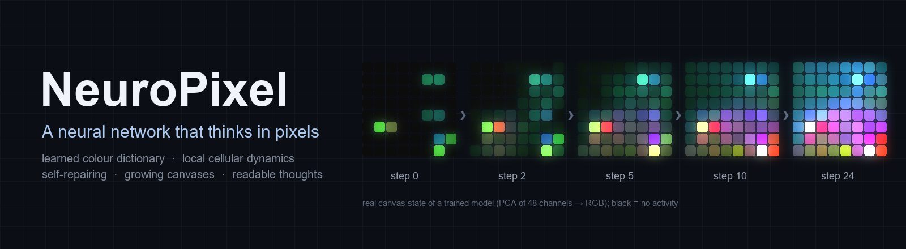
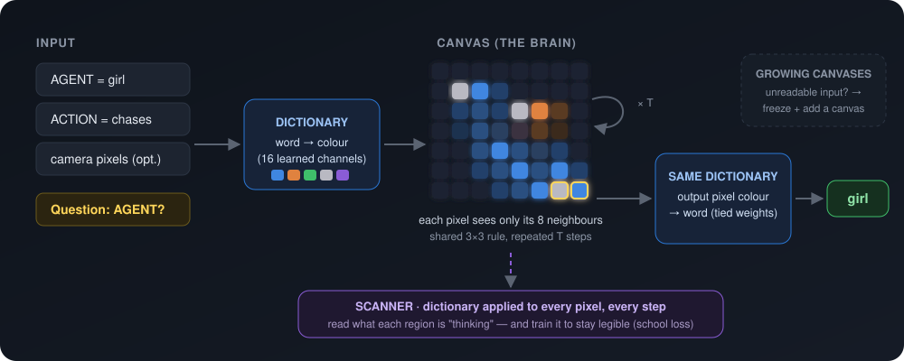
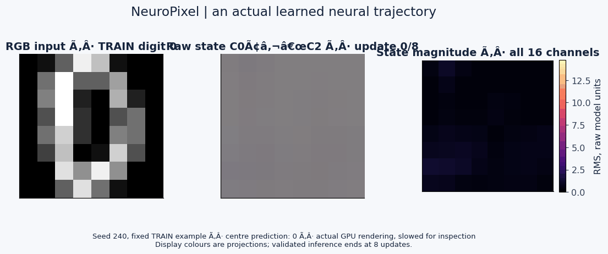
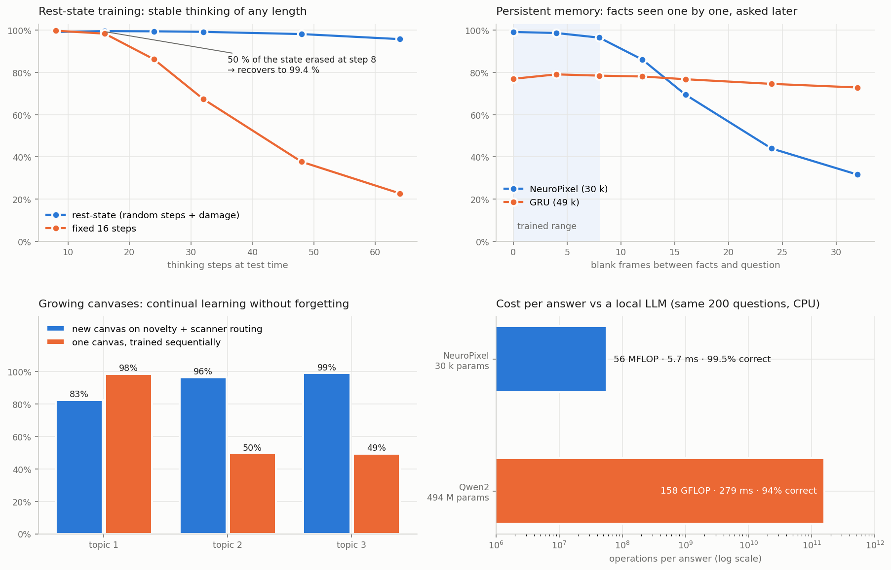
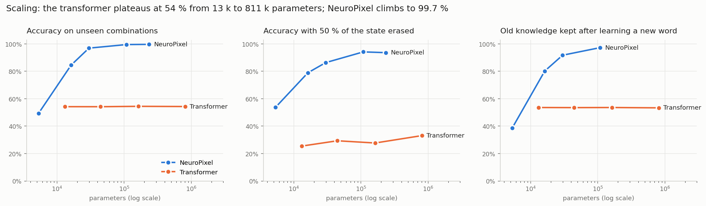
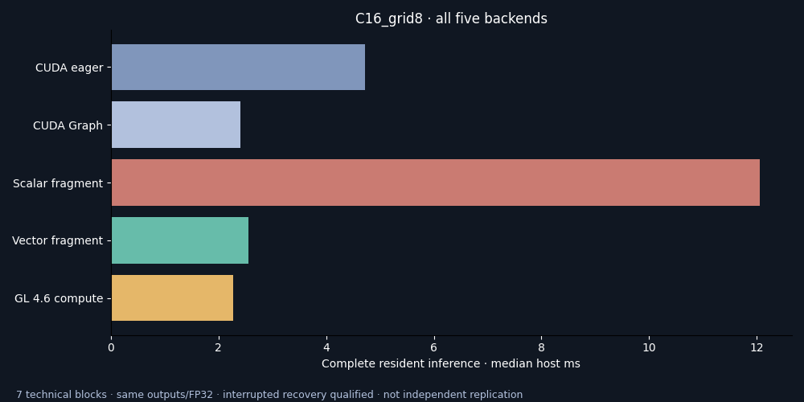
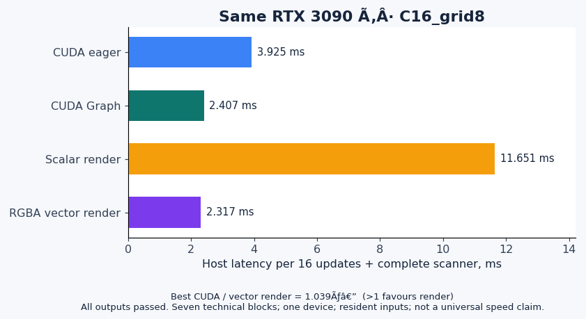
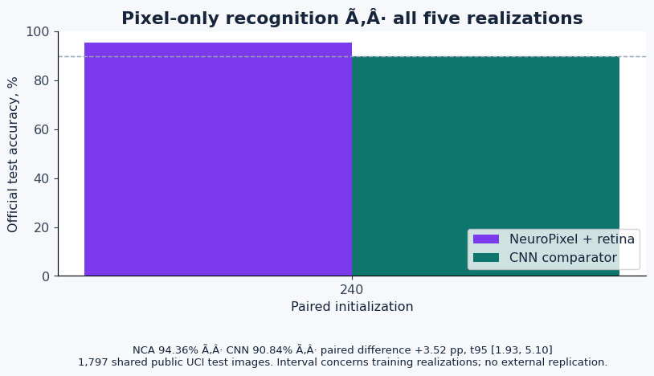
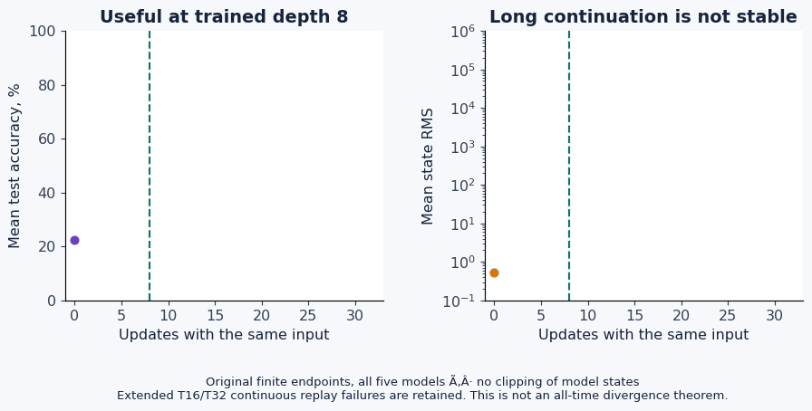
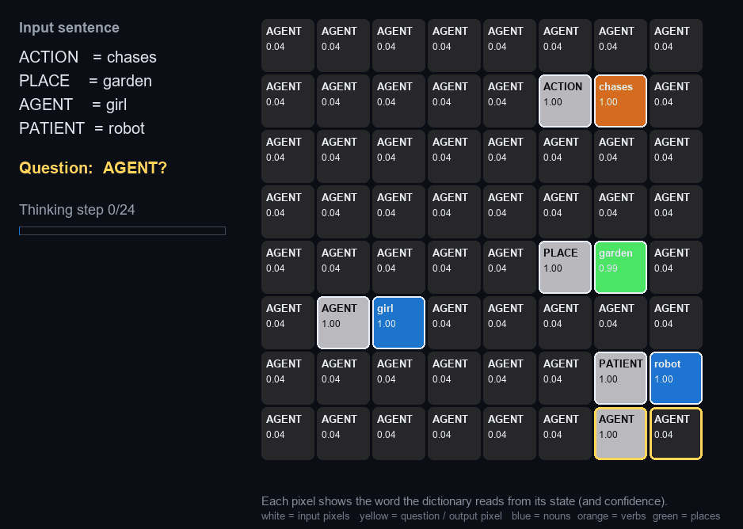

  

# NeuroPixel

### Neural fields executed as images — visible states, measured results

NeuroPixel represents a recurrent neural state on a spatial canvas. Local learned updates evolve the field; a shared dictionary reads the result. The graphics implementation executes perception, local updates, retina and decoding through floating-point image passes. It provides an inspectable artificial neural process, rather than a claim of a biological brain or a complete causal explanation.

  

*Actual learned network trajectory of the selected VIS07 model. File `docs/animations/actual_neural_trajectory.gif` (339.6 KiB, SHA-256 `3cc78dacc2d1…`). Frames are actual GPU-rendered states of the selected model, labelled as such; no synthetic artwork. See the [manifest](docs/animations/manifest.json).*

**Actual GPU-rendered states**, selected VIS07 model, registered seed240 and fixed original TRAIN digit0. Playback is slowed for inspection. Colours display a projection of raw channels; magnitude is shown separately. The validated classifier uses eight updates and resets for each new input.

## What has been measured (internal evidence, levels L1–L2)

| Question | Complete measured result | Evidence and scope |
|---|---|---|
| Can rendering reproduce the neural computation? | **136 engineering checks passed on RTX3090**, including pixel retina, state updates, masks, full logits and decisions. Learned deployment also retained all **320 tested decisions** across five models. | [GPU fidelity](docs/research/REPRODUCE_20261009.md); FP32, fixed checks and explicit subset. |
| Does an external pixel-only task work? | **94.36%** NeuroPixel versus **90.84%** CNN; paired difference **+3.52pp**, exploratory t95 **[1.93,5.10]pp**. | [VIS07](docs/research/VIS07_results.md): five paired fits, official UCI test1797images, DEV-only selection, near nominal parameter counts, differing functions/costs. Under a one-column shift NeuroPixel fell to **55.83%** versus **85.12%** for the CNN; at half intensity it kept **88.74%** versus **67.06%** ([claims ledger](docs/research/claims_ledger.json), D-VIS07-05). |
| Can graphics execution be faster? | RGBA vector rendering measured **1.536×** relative to the best CUDA comparator for C16/grid128. Other workloads do not uniformly win. | [RENDER09](docs/research/RENDER09_results.md): same GPU/outputs/FP32, CUDAeager andCUDAgraph, all seven workloads shown. |
| Does query-dependent spatial reading help binding? | GLOB05 attention minus active global uniform control **+6.28pp**, exploratory IC95 **[4.11,8.45]pp**. | [GLOB05](docs/research/GLOB05_results.md): twelve fixed bodies, equal registered budget/supervision; internal development, not external replication. |
| Does graphics execution use less GPU-board energy? | Sometimes. Over the complete 105-row cohort the best render-family method used less board energy per call than the best CUDA method in **4 of 7** workloads and more in **3 of 7**: for example **0.485 J** versus **0.641 J** on C16/grid128, but **2.554 J** versus **1.818 J** on C48/grid128. | [RENDER11](docs/research/RENDER11_results.md) (G-R11-01): whole-board NVML counters, median of three technical blocks; technical ranges overlap in 4 of 7 workloads; CPU, RAM and wall energy unmeasured. |
| Does local coupling store memories better than a global network of the same size? | No, in the closest antecedent test. With 64 binary cells and eight stored patterns, a global Hopfield network exactly repaired **85–95.5%** of erased and noisy cues; restricting the same coupling to 3×3 neighbourhoods failed from four patterns (**0–2%**), and an explicit nearest-pattern decoder identified the target in every condition. | [ANT01](docs/research/ANT01_results.md) (ANT01-01): plan frozen before execution; Hebbian variants, not the learned NeuroPixel rule. |
| Are the negative results preserved? | Yes. OriginalH1 remains unsupported; DEV04 original precision target failed; long continuations are not stable; VIS07 accuracy collapses under a one-column shift (55.83% versus 85.12% for the CNN). | [DEV04](docs/research/DEV04_results.md), [historical audit](docs/research/TASK4_historical_capabilities_audit_20261009.md), [limits](docs/research/COST_AND_LIMITS_20261009.md). |

These are results of the specified recipes and device. They do not establish general architectural superiority, independent external replication or a Nobel-level discovery.

  

*Capability figure from the pre-scientific README (illustrative, level L0, not registered evidence). Memory, rest-state and growth behaviour are not established by the current evidence; see the manuscript and the claims ledger for the bounded claims.*

  

*Historical retrospective scaling comparison (level L0: its reassessment outputs are not retained). The prospective test of the original hypothesis H1 was not supported (-37.0 pp versus the fixed Transformer); see the results index.*

## Graphics backends and fair acceleration controls

The original scalar renderer uses RGBA32F textures and framebuffer passes. The vector renderer packs coefficients and performs four-channel fetches/DOT4. The advanced OpenGL 4.6 backend uses compute shaders, SSBO weights and shared pixel tiles. Its complete comparison passed **77 output gates and all 245 timing rows**, preserving the original 143 rows without repeating them. Compute measures **2.084×** relative to the best CUDA comparator for C16/grid128, and loses for C48/grid128. Recovery interrupted measurement sessions; results are descriptive technical measurements, not independent replications. [All RENDER10 cases and limits](docs/research/RENDER10_results.md).

*The five advanced GPU backends on the same network state; provenance in [advanced_GPU_backends_provenance.json](docs/animations/advanced_GPU_backends_provenance.json). File `docs/animations/advanced_GPU_backends.gif` (71.3 KiB, SHA-256 `efe22459cffc…`). Frames are actual GPU-rendered states of the selected model, labelled as such; no synthetic artwork. See the [manifest](docs/animations/manifest.json).*

*All graphics workloads and their comparators. File `docs/animations/all_GPU_workloads.gif` (161.4 KiB, SHA-256 `87a3572584c1…`). Frames are actual GPU-rendered states of the selected model, labelled as such; no synthetic artwork. See the [manifest](docs/animations/manifest.json).*

The first scalar implementation was **3.14–12.24× slower** than the best measured CUDA comparator. It is retained as a within-run control. The vector variant improves that implementation; advantages are workload-dependent. CUDA Graph is included to reduce avoidable Python launch overhead. Technical timing blocks are not independent scientific replications.

Timing uses resident inputs, sixteen updates and the complete scanner. Setup/compilation, transfers, training and archival are distinct costs. Short NVML counter deltas cannot establish per-inference energy savings; zero readings are not zero consumption. Whole-system wall energy has not been measured.

## End-to-end visual learning

RGB pixels feed a learned retina, neural state and shared decoder. No target label or class token is inserted as image input. Five new pairs received the same training examples, orders, labels and forty-epoch budget. Ten DEV-selected models were sealed before official test scoring. Code and original weights are preserved; inference can run through graphics, while this study's training used PyTorchCPU.

*All five visual realizations of the VIS07 pairs. File `docs/animations/external_vision_all_seeds.gif` (126.6 KiB, SHA-256 `50243fe28a7c…`). Frames are actual GPU-rendered states of the selected model, labelled as such; no synthetic artwork. See the [manifest](docs/animations/manifest.json).*

The corpus is public UCI optical digits. The metadata documents separate writers for official TRAIN/TEST; exact input-image identities were disjoint. It is a bounded recognition benchmark, not natural-language reasoning, blind custody or independent laboratory confirmation. NCAclassification and WebGL execution have [primary antecedents](https://distill.pub/2020/growing-ca/).

## Time, stability and honest introspection

*Finite-depth limits: state growth when the same input is extended beyond the eight trained updates. File `docs/animations/depth_limits_and_state_growth.gif` (133.7 KiB, SHA-256 `09e0cca97300…`). Frames are actual GPU-rendered states of the selected model, labelled as such; no synthetic artwork. See the [manifest](docs/animations/manifest.json).*

Eight updates are trained. Extending the same input to sixteen or thirty-two updates degrades accuracy and grows the recorded state magnitude. Ten extended-logit comparisons failed the original replay tolerance and remain archived, even though categorical decisions matched. A fixed same-host128-row diagnostic reproduced both code paths and archived values; it does not erase the earlier failed execution.

  

*Dictionary scanner reading the canvas while it answers a question. File `docs/img/thinking.gif` (1315.2 KiB, SHA-256 `339b5dcf6cd5…`), generated by `scripts/make_readme_figures.py`.*

The scanner projects state through a learned decoder. [SCN06](docs/research/SCN06_results.md) demonstrates that identical present displays can hide state differences that affect a future answer. Seeing a colour is useful observability, not unique causal circuit identification or biological equivalence.

## Completion programme (12–13 October 2026): audit, registry and new tests

The project is now run as a staged completion programme whose plan, task ledger and session log are versioned with the code ([ExecPlan](docs/execplan/EXECPLAN.md)). What it has added so far:

- **Every public claim is registered and levelled.** The [claims ledger](docs/research/claims_ledger.json) maps all 795 public statements of this README, the manuscripts and the study reports to **78 claims** bound to retained artifacts: **31 at L2** (registered experiment, internal), **37 at L1** (engineering or audit) and **10 at L0** (not reproducible from retained files, kept and labelled). The validator reports zero violations. An independent verification found two registered VIS07 test conditions that had never been reported; both are now published above, and 22 text corrections are archived in [A18 corrections](docs/research/A18_text_corrections_20261013.md). No claim exceeds L2.
- **The archive is intact.** At the base commit all 1,797 raw blobs of the publication manifest match their Git identities and SHA-256 values, all 44 declared origin commits are available and 417 further artifacts are hashed ([G0 inventory](docs/research/COMPLETION_G0_inventory_20261012.md)). The release audit's four open issues, including the incomplete energy evidence, were reconciled rather than deleted.
- **The energy cohort is complete.** The original RENDER11 receipt with 103 of 105 rows and the recovery of the two missing keys were admitted by SHA-256 without new measurements; the complete comparison is the energy row of the table above.
- **The zero-depth contract is fixed and checked.** A new model version handles T = 0 explicitly. On CPU with Torch 2.6.0, the three original T0 tests and seven new contracts passed, including bit-identical outputs of the patched and frozen forward passes at positive depth. The frozen original checkout is kept separately, and the affected graphics-backend controls are still pending.
- **The closest antecedent was tested directly.** [ANT01](docs/research/ANT01_results.md) compares global and locally coupled Hopfield memory at equal state size; in that test locality adds no storage (table above). The [antecedent table](docs/papers/NeuroPixel_manuscript_completion_draft.md) answers Hopfield, Turing, reservoirs, fading memory, DEQ, NCA, continuous attractors and continual learning, mostly with "not established".
- **Information ceilings are checked numerically.** In exact enumeration over 3–8 bits and six noise levels, none of 27,846 one-bit functions, including every elementary cellular-automaton readout after one to three steps, exceeded the channel ceiling 1 − h₂(p) ([MATH119](docs/research/MATH119_results.md)). These are finite checks of examples, not a proof.
- **Statistics are fixed at programme level.** A [programme registry](docs/research/program_registry.json) applies online Bonferroni control (total α = 0.05, first threshold 0.0304) to every future confirmatory hypothesis and forbids equivalence claims without a pre-registered margin. Hierarchical bootstrap and specification curves agree in sign with the registered intervals ([G18](docs/research/G18_program_statistics_20261013.md)). All earlier studies remain exploratory.
- **Blind custody is ready but not yet independent.** A commit–reveal procedure for future TEST sets passed all nine rehearsal steps with dummy material and rejected tampered openings ([custody procedure](docs/research/G17_custody_procedure_20261013.md)). A new relational task family has leakage-checked TRAIN/DEV splits; its TEST split is reserved for an independent evaluator ([separation and exposure](docs/research/G3_separation_and_exposure_20261013.md)).

**Next question.** The programme has chosen one central question with a scored [decision matrix](docs/research/BET01_decision_matrix.json): can a locally coupled field keep a memory and repair damage at the same time, and how close does it come to the information ceiling? Its [preregistration draft](docs/research/BET01_plan.json) states the hypothesis, endpoints, tolerances and stop rules, and was red-teamed before commitment. It becomes binding only after a cryptographic commitment with an external timestamp. Current evidence for this line is weak or negative (historical memory admission failed; states diverge beyond the trained depth; ANT01), and the stop rules say so in advance.

## Reproduce and inspect every result

An [interactive local viewer](docs/research/VIS07_viewer.md) exposes all sixteen raw channels, selectable RGB projection, per-cell decoder probabilities and reset/depth controls. Archive mode passed fifty HTTP checks and browser controls. Live physical GPU integration passed **27 trajectory gates plus 52 HTTP checks**, including all ten TRAIN resets and clean release. A separate CPU/Mesa execution passed the same integration checks; software and archive modes are labelled explicitly and are not presented as physical GPU execution.

The [sustained energy protocol](docs/research/RENDER11_energy_protocol.md) uses actual board counters over multi-second blocks. Its first execution passed all 77 output gates and preserved 103 of 105 blocks before the unchanged RAM floor stopped it. A recovery measured the two missing RGB8 block-2 keys; the completed cohort has 105 rows, 77 gates and zero repeated keys, with the [admitted per-case table](results/research/COMPLETION20261012/energy_complete_summary.json), [recovered receipt](results/research/RENDER11_energy/recovered_20261009B/receipt.json) and [SHA-256 admission proof](results/research/COMPLETION20261012/energy_recovery_admission.json). This saved internal recovery adds no independent replicate. Full wall energy is unmeasured.

- [Reproduction instructions and environments](docs/research/REPRODUCE_20261009.md)
- [All-study evidence index](docs/research/RESULTS_INDEX_20261009.md)
- [Scientific manuscript: methods, results and open requirements](docs/papers/NeuroPixel_manuscript_20261009.md), with the [completion-phase draft](docs/papers/NeuroPixel_manuscript_completion_draft.md) (antecedents, new tests) and the [reconciled evidence note](docs/papers/NeuroPixel_evidence_reconciled_20261012.md)
- Evidence levels and limits of every public statement: [claims ledger](docs/research/claims_ledger.json); error control for future confirmatory tests: [programme registry](docs/research/program_registry.json)
- Completion programme state, decisions and pending owner actions: [ExecPlan](docs/execplan/EXECPLAN.md)
- Frozen plans, original checkpoints, datasets, raw predictions/states, failed attempts and hash manifests under `results/research/`, except the item-5 CPU archive and the historical reassessment outputs, which are unavailable; large recovery archives remain on local disks outside the Git tree.
- Scientific animation provenance: [manifest](docs/animations/manifest.json). Animations derive from actual data; no synthetic brain artwork.
- Original README and prior versions are retained in the archive and Git history.

CPU studies used Python3.12.14/Torch2.6.0+cpu, two threads and a minimum8GiB availableRAM. GPU tests used RTX3090/NVIDIA581.29, Torch2.6.0+cu124 and ModernGL5.12/glcontext3. The completion checks used Python 3.13.7: with Torch 2.6.0 on CPU under the 8 GiB guard for the zero-depth contract, and in a separate NumPy/SciPy environment without neural libraries for ANT01, MATH119 and the claims ledger. Training and heavy neural loading require the resource guard and shared GPU queue. Never rerun closed fits to improve an interval.

## License and attribution

Code: [MIT](LICENSE). Optical-digits data: Alpaydin & Kaynak(1998), [UCI DOI10.24432/C50P49](https://archive.ics.uci.edu/dataset/80/optical+recognition+of+handwritten+digits), CC BY4.0. Historical bAbI data: Weston and colleagues; the [publisher dataset card](https://huggingface.co/datasets/facebook/babi_qa/blob/main/README.md) declares CC BY3.0. The historical acquisition report retains its mirror and upstream-checksum limitations. Third-party sources and internal reproduction are explicitly distinguished. Independent replication, full energy accounting, broad stable memory and exceptional original utility remain open research requirements.
